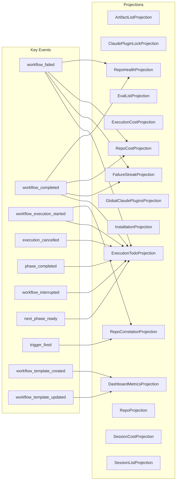

# Projection Subscriptions

🤖 **Auto-generated from VSA manifest** - Run `just docs-regen` to update

**Data Source:** `.topology/syn-manifest.json`

---

## Overview

This diagram shows which events feed which projections in the Syn137 system.

**Total Relationships:** 82 events → 28 projections



---

## Statistics

- **Events with projections:** 82
- **Unique projections:** 28
- **Total event-to-projection mappings:** 130

---

## Top Events by Projection Count

| Event | Projections | Count |
|-------|-------------|-------|
| workflow_failed | ExecutionTodoProjection, FailureStreakProjection, RepoCostProjection... | 7 |
| workflow_completed | ExecutionTodoProjection, FailureStreakProjection, RepoCostProjection... | 6 |
| workflow_execution_started | ExecutionTodoProjection, RepoCorrelationProjection, WorkflowDetailProjection... | 6 |
| execution_cancelled | ExecutionTodoProjection, WorkflowExecutionDetailProjection, WorkflowExecutionListProjection... | 4 |
| phase_completed | ExecutionTodoProjection, WorkflowExecutionDetailProjection, WorkflowExecutionListProjection... | 4 |
| workflow_interrupted | ExecutionTodoProjection, WorkflowExecutionDetailProjection, WorkflowExecutionListProjection... | 4 |
| next_phase_ready | ExecutionTodoProjection, WorkflowExecutionDetailProjection, WorkflowExecutionListProjection | 3 |
| trigger_fired | RepoCorrelationProjection, TriggerHistoryProjection, TriggerRuleProjection | 3 |
| workflow_template_created | DashboardMetricsProjection, WorkflowDetailProjection, WorkflowListProjection | 3 |
| workflow_template_updated | DashboardMetricsProjection, WorkflowDetailProjection, WorkflowListProjection | 3 |

---

## Related Documentation

- [Event Architecture](./event-architecture.md) - Domain vs Observability events
- [Infrastructure Data Flow](./infrastructure-data-flow.md)

---

🤖 **This file is auto-generated** - Do not edit manually. To regenerate:

```bash
just docs-regen
```
