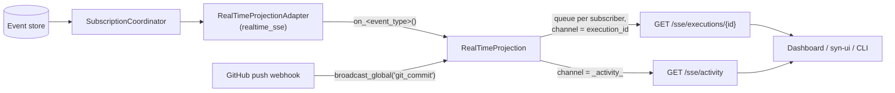
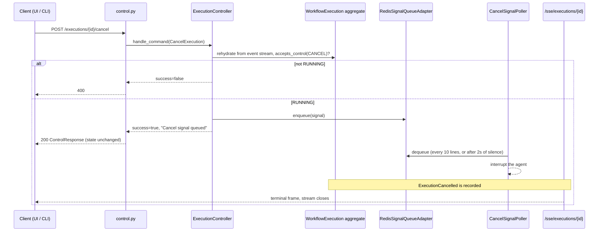

# Real-time Communication Architecture

**Last Updated:** 2026-10-24
**References:** [ADR-049: SSE for Real-Time Execution Streams](../adrs/ADR-049-sse-over-websocket-for-execution-streams.md), [ADR-019: WebSocket Control Plane Architecture](../adrs/ADR-019-websocket-control-plane.md) (historical title; its notes record the removal), [ADR-055: Projection Checkpoint Coordinator](../adrs/ADR-055-projection-checkpoint-coordinator-architecture.md)

---

## Overview

Real-time communication is two separate, one-directional paths:

| Path | Direction | Mechanism | Routes |
|------|-----------|-----------|--------|
| **Observation** | server → client | Server-Sent Events (`text/event-stream`) | `GET /sse/executions/{execution_id}`, `GET /sse/activity`, `GET /sse/health` |
| **Control** | client → server | Plain HTTP request/response | `POST /executions/{execution_id}/cancel`, `POST /executions/{execution_id}/inject`, `GET /executions/{execution_id}/state` |

There is no WebSocket anywhere in the API, the dashboard, syn-ui or the CLI.
See [History](#history) for what was removed and why.

Route paths above are as the API serves them. Browsers and the CLI reach them
under `/api/v1`, which the gateway and the Vite dev proxy strip before
forwarding (see [Reaching the API](#reaching-the-api)).

---

## Observation: Server-Sent Events

### Data flow

1. Domain events reach `RealTimeProjectionAdapter`
   (`packages/syn-adapters/src/syn_adapters/subscriptions/realtime_adapter.py`).
   `CoordinatorSubscriptionService` adds it to the coordinator's projection list
   when a realtime projection is configured (`coordinator_service.py`).
2. The adapter turns the event type into a handler name (`PhaseStarted` →
   `on_phase_started`) and calls it on `RealTimeProjection`
   (`packages/syn-adapters/src/syn_adapters/projections/realtime.py`).
   `ExecutionCancelled` is validated into `ExecutionCancelledPayload` first; the
   other events are passed as their `model_dump(mode="json")`.
3. `RealTimeProjection` keeps one `asyncio.Queue` per connected subscriber,
   grouped by channel: an execution id, or `_activity_` for the global feed. It
   persists nothing. A broadcast wraps the event in an `SSEEventFrame` and puts
   it on every queue for that channel.
4. The route in `apps/syn-api/src/syn_api/routes/sse.py` reads its queue and
   writes frames to the response. Routes reach the projection through
   `apps/syn-api/src/syn_api/services/realtime.py`, which gets the singleton
   from `_wiring.get_realtime()`.

The realtime projection lives in process memory, so a client connected to one
API process only sees events that process's coordinator dispatches. A
disconnected client misses whatever was broadcast while it was away; nothing is
buffered for it.

### Endpoints

| Route | Channel | Ends when |
|-------|---------|-----------|
| `GET /sse/executions/{execution_id}` | the execution id | a terminal frame is delivered, or the client disconnects |
| `GET /sse/activity` | `_activity_` | the client disconnects (it has no terminal event) |
| `GET /sse/health` | none | plain JSON, not a stream: `SSEHealthResponse` with `status`, `active_executions` (channels with a subscriber) and `active_connections` (subscriber queues) |

The execution id is used as given. It is not prefix-resolved, so a client must
pass the full id.

### Wire format

Every data frame is one line, `data: <SSEEventFrame JSON>`, followed by a blank
line. No `event:` line is ever written, so `EventSource.onmessage` receives
every frame and clients switch on the JSON's `event_type`.

`SSEEventFrame` (`projections/realtime.py`, `frozen=True`, `extra="forbid"`):

| Field | Type | Meaning |
|-------|------|---------|
| `type` | `"connected" \| "event" \| "terminal"` | frame kind |
| `event_type` | `str` | domain event type, `git_commit`, or `connected` |
| `execution_id` | `str \| None` | the channel's execution id; `None` on the activity channel |
| `data` | `dict[str, JsonValue]` | the event payload |
| `timestamp` | `str` | ISO 8601, set when the frame is built |

Stream lifecycle, per connection:

1. The route calls `realtime.connect(channel)` and gets a fresh queue.
2. It sends a `connected` handshake frame. Its `data` is `{}` on an execution
   stream and `{"channel": "activity"}` on the activity stream.
3. It waits on the queue for up to 30 seconds. A timeout writes the comment
   `: keepalive`, which carries no data and keeps proxies from closing an idle
   connection.
4. A terminal broadcast puts the frame and then a `None` sentinel on the queue.
   The route delivers the frame and ends the response on the sentinel.
5. In a `finally` block it calls `realtime.disconnect(channel, queue)`, which
   drops the channel once its last subscriber leaves.

Responses carry `Cache-Control: no-cache` and `X-Accel-Buffering: no`; the
second tells nginx not to buffer the stream.

### Event types

`RealTimeProjectionAdapter.get_subscribed_event_types()` is the list of domain
events that reach SSE at all. Each is sent on its execution's channel when the
event carries a string `execution_id`. Some are also copied to the activity
channel so list views can update without polling.

| `event_type` | Execution channel | Activity channel | Terminal |
|--------------|:-----------------:|:----------------:|:--------:|
| `WorkflowExecutionStarted` | yes | yes | |
| `PhaseStarted` | yes | | |
| `PhaseCompleted` | yes | | |
| `OperationRecorded` | yes | | |
| `ArtifactCreated` | yes | | |
| `SessionStarted` | yes | yes | |
| `SessionCompleted` | yes | yes | |
| `WorkflowCompleted` | yes | yes | yes |
| `WorkflowFailed` | yes | yes | yes |
| `ExecutionCancelled` | yes | yes | yes |
| `git_commit` | | yes | |

`git_commit` is not a domain event from the coordinator. The GitHub push
webhook handler (`apps/syn-api/src/syn_api/routes/webhooks/push_events.py`)
records each commit and calls `broadcast_global("git_commit", data)` directly.

The terminal flag applies to the execution channel only. On the activity
channel the same events are ordinary `event` frames, and that stream never
ends.

### Clients

| Client | File | How |
|--------|------|-----|
| Dashboard (`apps/syn-dashboard-ui`) | `src/hooks/useExecutionStream.ts` | one `EventSource` on `${API_BASE}/sse/executions/{id}`, relying on the browser's automatic reconnect |
| | `src/hooks/useActivityStream.ts` | one `EventSource` on `${API_BASE}/sse/activity` per tab, shared by every consumer |
| | `src/api/observability.ts` | builds the execution stream URL; fetches `/sse/health` |
| syn-ui (`packages/syn-ui/data`) | `src/live/stream.ts` | `liveHub`: one refcounted `EventSource` per URL per tab, its own backoff reconnect when the browser gives up, and an `onReconnect` callback so subscribers refetch rather than trust a stream that may have missed frames |
| | `src/live/events.ts`, `src/live/invalidate.ts` | parse frames and map them to query-cache invalidations (`invalidationsFor`, `connectLiveInvalidation`, `connectExecutionInvalidation`) |
| CLI (`apps/syn-cli-node`) | `src/client/sse.ts` | `streamSSE(path)` over `fetch`; `SSEPath` is the type `` `/sse/${string}` `` |
| | `src/commands/watch.ts` | `syn watch execution <id>` and `syn watch activity` |

Both web apps use `API_BASE = '/api/v1'`. The CLI reads `SYN_API_URL` and adds
`/api/v1` itself (`API_PREFIX` in `src/client/constants.ts`).

---

## Control: HTTP

Control is ordinary request/response, defined in
`apps/syn-api/src/syn_api/routes/executions/control.py`:

| Route | Body | Does |
|-------|------|------|
| `POST /executions/{execution_id}/cancel` | `CancelRequest` (`reason`, optional) | queues a cancel signal, or withdraws a start still queued for a slot (#1650) |
| `POST /executions/{execution_id}/inject` | `InjectRequest` (`message`, `role`: `user` or `system`) | queues an inject signal; see [Known gaps](#known-gaps) |
| `GET /executions/{execution_id}/state` | none | `StateResponse`: the execution's status, read from its event stream |

Cancel and inject return `ControlResponse` (`success`, `execution_id`, `state`,
`message`, `error`); a refused request is HTTP 400. These routes accept an id
prefix: a prefix is resolved through the `workflow_execution_details` read
model, which answers 409 while that model is rebuilding (#1555).

- **Who decides.** `ExecutionController`
  (`packages/syn-adapters/src/syn_adapters/control/controller.py`) holds no
  rule of its own. It rehydrates the aggregate on every request and asks
  `WorkflowExecutionAggregate.accepts_control()`, which admits cancel and
  inject only while the status is `RUNNING` (ADR-014 s7). An execution with no
  stream, or a store that cannot be read, is refused.
- **A 200 means queued, not done.** The response's `state` is the state before
  the signal is acted on. Clients learn the outcome from the
  `ExecutionCancelled` frame on the execution stream, or from `/state`.
- **The queue.** `_wiring.get_controller()` uses `RedisSignalQueueAdapter`
  (`control/adapters/redis_adapter.py`): one short-lived key per execution,
  5-minute TTL, claimed and then acknowledged on read. If Redis cannot be set
  up, a null adapter is used and signals are not delivered.
- **The reader.** `CancelSignalPoller`
  (`packages/syn-domain/.../slices/execute_workflow/CancelSignalPoller.py`)
  polls from both `EventStreamProcessor` and `CodexStreamProcessor`, every 10
  output lines and whenever the agent has been quiet for
  `CANCEL_POLL_SECONDS` (2.0).

CLI commands (`apps/syn-cli-node/src/commands/control.ts`, group `control`):
`cancel`, `stop` (cancel with `--force` and a default reason), `inject` and
`status` (`GET .../state`). The dashboard (`src/api/executions.ts`) and syn-ui
(`data/src/resources/executions.ts`) call the cancel route.

`POST /executions/{execution_id}/resume` (`routes/executions/resume.py`) is
not a control action. It starts a new run from a terminal one (ADR-014 s7) and
does not touch the signal queue.

---

## Reaching the API

| Where | `/api/v1` handling |
|-------|--------------------|
| Vite dev server | `apps/syn-dashboard-ui/vite.config.ts` proxies `/api/v1` and strips the prefix |
| Gateway, dev | `infra/docker/images/gateway/nginx.conf.dev`, `location /api/v1/` rewrites the prefix away and sets `proxy_buffering off` |
| Gateway, selfhost | `infra/docker/images/gateway/docker-entrypoint.sh` generates `location /api/v1/` → `http://api:8000/` with `proxy_read_timeout 300s`. SSE streams pass through this generic location; buffering is turned off by the API's `X-Accel-Buffering: no` header, and the 30-second keepalive is well inside the read timeout |

---

## Known gaps

Each of these is a fact about the code on the date above, not a design intent.

- **Inject is accepted but not delivered** (#1530). The controller queues an
  `INJECT` signal and answers success, but the only reader,
  `CancelSignalPoller`, acts on `CANCEL` alone. Nothing passes
  `inject_message` to the agent.
- **Subagent events never reach SSE.** `RealTimeProjection` has
  `on_subagent_started` and `on_subagent_stopped`, but `SubagentStarted` and
  `SubagentStopped` are not in the adapter's subscribed event types, so those
  handlers are never called.
- **The selfhost gateway still proxies removed paths.** The generated config
  keeps `location /ws/`, `location /api/v1/ws` and `location /api/v1/stream`.
  No API route exists behind any of them; the real streams use
  `location /api/v1/`.
- **Stale comments in `_wiring.get_controller()`** still mention
  pause/resume.

---

## History

- **Until March 2026** the API served WebSocket endpoints:
  `/ws/executions/{id}`, `/ws/activity`, `/ws/health`, and a bidirectional
  control channel `/ws/control/{id}`. Observation is one-directional and the
  control channel duplicated the HTTP routes, so all four were removed in
  favour of SSE: ADR-049 (accepted 2026-03-21), implemented in
  [#264](https://github.com/syntropic137/syntropic137/pull/264) (ISS-262,
  committed 2026-03-22). The
  removal note is also in ADR-019.
- **2026-09-29**: execution pause and resume were deleted
  ([#1471](https://github.com/syntropic137/syntropic137/pull/1471)). Nothing
  ever read the pause signal, and `ExecutionStatus.PAUSED` went with them. The
  control plane now carries cancel and inject only. Earlier versions of this
  document, which describe the WebSocket channel and a pause/resume state
  machine, are in git history.

---

## Related Documentation

- [ADR-049: SSE for Real-Time Execution Streams](../adrs/ADR-049-sse-over-websocket-for-execution-streams.md)
- [ADR-019: WebSocket Control Plane Architecture](../adrs/ADR-019-websocket-control-plane.md) (historical title; its notes record the removal)
- [ADR-055: Projection Checkpoint Coordinator](../adrs/ADR-055-projection-checkpoint-coordinator-architecture.md)
- [Projection Subscriptions](./projection-subscriptions.md)
