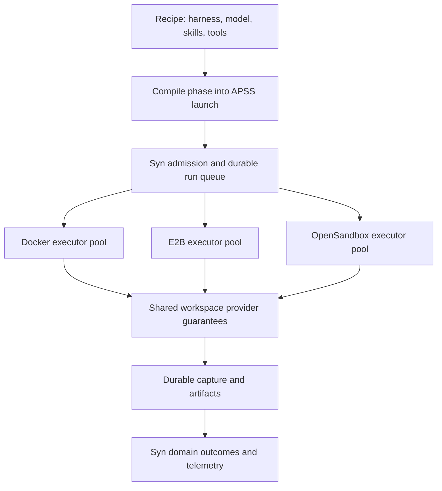

# Workspace runtime design from Harbor and OpenSandbox

Retain APSS as the portable agent launch contract. Borrow Harbor's provider adapters, capability checks and resource semantics; evaluate OpenSandbox's lifecycle/execution protocols and warm inventory. Complete Syntropic137's existing durable executor design. Neither reference supplies the complete mixed-provider, crash-safe fleet Syntropic needs.

This is a proposed design baseline, not an accepted ADR or a completed implementation. It separates existing requirements, implementation debt and candidate contract changes.

## Evidence and scope

| System | Reviewed baseline | Evidence |
|---|---|---|
| Harbor | v0.24.0, commit b53b8134e1241686dca7759af188f987ecc48e8b; release 2026-10-05 | [Source dossier](2026-10-12-harbor-source-review.md) |
| OpenSandbox | release-1.1.1, commit 531700ca18a7fa5fab6a2f25d6dc68a76eddab12; release 2026-10-09 | [Source dossier](2026-10-12-opensandbox-source-review.md) |
| APSS | EXP-V1-0006 v0.1.0 Experimental, commit 18d55b231e7d06b509386b2599f925195b63ba0c | [Pinned dependency](../../lib/agentic-workspace/Cargo.toml), [normative spec](https://github.com/AgentParadise/agent-paradise-standards-system/blob/18d55b231e7d06b509386b2599f925195b63ba0c/standards-experimental/v1/EXP-V1-0006-workspace/docs/01_spec.md) |
| Syntropic137 | Current working tree, 2026-10-12 | Source paths in gap matrix; existing local changes preserved |

Static source and test inspection, release/activity review, plus 16 passing OpenSandbox Go SDK mock pool tests. No live sandbox, crash-recovery, security exploit or fleet load test. Stable behavior is separated from later PRs. Neither project is certified safe or scalable to 1,000 by this review.

## The references occupy different layers

Harbor is an agent evaluation framework. Its environment abstraction maps one common lifecycle/process/files interface to many vendors. OpenSandbox is already one Harbor environment provider. OpenSandbox supplies a lifecycle service, in-sandbox execution API, SDKs and infrastructure backends. They are complementary references, not two interchangeable schedulers. [Harbor registry](https://github.com/harbor-framework/harbor/blob/b53b8134e1241686dca7759af188f987ecc48e8b/src/harbor/environments/factory.py#L28), [OpenSandbox lifecycle port](https://github.com/opensandbox-group/OpenSandbox/blob/531700ca18a7fa5fab6a2f25d6dc68a76eddab12/server/opensandbox_server/services/sandbox_service.py#L42).



Each pool binds one provider implementation plus account/region/security configuration. Multiple pools run simultaneously. Workflows express requirements; placement chooses compatible capacity. An OpenSandbox-backed pool can use Docker or Kubernetes underneath without exposing that choice to workflow authoring.

Placement granularity matters: Syn's current run queue claims a workflow execution, while an APSS launch represents one executable phase. Preserve execution-level ownership initially and select a pool compatible with all its declared phases. Moving phases between pools requires an explicit scheduling change; the provider abstraction alone does not implement that handoff. The diagram shows conceptual boundaries, not the current order of admission calls.

## Patterns to reuse

| Pattern | Source behavior | Application to Syn/APSS |
|---|---|---|
| Small common port, optional profiles | Harbor async lifecycle/exec/files plus optional SSH and service operations | Baseline headless agent execution; optional PTY, services, snapshots and interaction |
| Explicit capabilities | Harbor distinguishes network-policy shapes and CPU/RAM requests versus limits | Match hard requirements before allocation; reject unsupported constraints |
| Lazy provider dependencies | Harbor imports selected adapter SDKs through its registry | Bind provider at pool bootstrap; isolate SDK failures and dependencies |
| Separate control and execution planes | OpenSandbox lifecycle API versus execd command/file API | APSS defines intent/guarantees; adapters choose transport |
| Endpoints carry authority | OpenSandbox returns address and required headers | Use scoped endpoint descriptors; retain proxy paths; redact credentials |
| Obtain identity before readiness | Harbor OpenSandbox adapter requests creation without inline health wait, then polls the returned resource | Persist allocated identity immediately; readiness failure should not create another resource |
| Safe retry classification | Harbor E2B retries selected pre-dispatch failures, not failed waits after dispatch | Unknown outcome triggers reconciliation, never automatic redispatch |
| Explicit ownership handoff | OpenSandbox warm acquisition transfers ownership after renewal/fence checks | Define who must clean up at each boundary, including cancellation |
| Reconciliation and conditional writes | OpenSandbox snapshot recovery/CAS and warm inventory fencing | Durable intent, guarded transitions and bounded cleanup, using existing Syn machinery |
| Immutable environment cache | Harbor hashes build content | Include all execution-affecting inputs and resolved identities in environment keys |

Sources: [Harbor capabilities](https://github.com/harbor-framework/harbor/blob/b53b8134e1241686dca7759af188f987ecc48e8b/src/harbor/environments/capabilities.py), [resource enforcement](https://github.com/harbor-framework/harbor/blob/b53b8134e1241686dca7759af188f987ecc48e8b/src/harbor/environments/resource_policies.py), [E2B dispatch](https://github.com/harbor-framework/harbor/blob/b53b8134e1241686dca7759af188f987ecc48e8b/src/harbor/environments/e2b.py#L432), [OpenSandbox readiness adapter](https://github.com/harbor-framework/harbor/blob/b53b8134e1241686dca7759af188f987ecc48e8b/src/harbor/environments/opensandbox.py#L376), [pool handoff](https://github.com/opensandbox-group/OpenSandbox/blob/531700ca18a7fa5fab6a2f25d6dc68a76eddab12/sdks/sandbox/python/src/opensandbox/pool_async.py#L977).

## Patterns that need stronger guarantees

**A common signature does not mean common behavior.** Harbor Docker merges stderr into stdout; its E2B/OpenSandbox adapters do not forward the shared output callback. Harbor's `stream` capability means SSH/TCP access, not general log streaming. `stop(delete=False)` kills E2B but leaves an OpenSandbox resource until expiry. Define these guarantees independently. [Provider comparison](2026-10-12-harbor-source-review.md#provider-comparison).

**Warm inventory is not admission control.** OpenSandbox `max_idle` bounds ready idle sandboxes. Borrowed sandboxes and direct-create fallback can exceed it. Redis coordinates idle inventory and leader replenishment, not ownership of the user's workflow. Harbor TrialQueue uses local asyncio semaphores. Neither is a substitute for Syn's durable active-resource budget. [Pool contract](https://github.com/opensandbox-group/OpenSandbox/blob/531700ca18a7fa5fab6a2f25d6dc68a76eddab12/docs/guides/client-pool.md#there-is-no-release), [TrialQueue](https://github.com/harbor-framework/harbor/blob/b53b8134e1241686dca7759af188f987ecc48e8b/src/harbor/trial/queue.py#L19).

**Reconnect is not durable execution recovery.** OpenSandbox reconnects by sandbox ID, but foreground SSE has no replay cursor; status and background logs are sandbox-local. Execd restart can lose command lookup. Harbor job resume reconciles local completed trial files; it does not establish distributed ownership of a live agent. Capture needs a separate durable export and completion barrier. [Command metadata/output](https://github.com/opensandbox-group/OpenSandbox/blob/531700ca18a7fa5fab6a2f25d6dc68a76eddab12/components/execd/pkg/runtime/command_status.go#L41), [Harbor resume](https://github.com/harbor-framework/harbor/blob/b53b8134e1241686dca7759af188f987ecc48e8b/src/harbor/job.py#L258).

**Test behavior across the wire.** OpenSandbox's spec describes background cursors as line indices; implementation uses byte offsets. Preserve provider cursors opaquely, normalize into a versioned capture cursor, and test reconnect with Unicode, partial writes and truncation. The implementation currently reads all remaining bytes, so cursor support alone does not bound memory. [Spec](https://github.com/opensandbox-group/OpenSandbox/blob/531700ca18a7fa5fab6a2f25d6dc68a76eddab12/specs/execd-api.yaml#L518), [implementation](https://github.com/opensandbox-group/OpenSandbox/blob/531700ca18a7fa5fab6a2f25d6dc68a76eddab12/components/execd/pkg/runtime/command_status.go#L75).

**Security remains deployment-specific.** OpenSandbox supports stronger runtimes, tenant authentication and scoped endpoint access, but these are not universal defaults. Docker defaults include host networking; an empty host-path allowlist permits all paths. Required user identity must fail if unsupported; Harbor's OpenSandbox adapter sometimes falls back instead. SDK security differs by language/version, including reported redirect credential forwarding. [Security evidence](2026-10-12-opensandbox-source-review.md#security-and-resource-semantics), [Harbor gotchas](2026-10-12-harbor-source-review.md#gotchas-worth-avoiding).

**HA claims need a boundary.** OpenSandbox has focused PostgreSQL/Kubernetes snapshot recovery tests. That does not establish whole-service HA, Docker timer/metadata failover or active agent takeover. Ordinary Docker pause and rootfs snapshots also do not promise memory-releasing hibernation or live migration. [Recovery evidence](2026-10-12-opensandbox-source-review.md#recovery-and-scale-limits).

## Proposed workspace contract

Keep APSS portable and small. Separate immutable launch intent from runtime identity, provider credentials and observations. Implement in Rust within agentic-workspace; adapt Syn's Python domain ports without moving harness-specific knowledge into Syn.

| Contract | Required meaning | Owner |
|---|---|---|
| Recipe | Versioned reusable harness/model/skills/tool requirements and instructions | agentic-workspace recipe layer |
| Launch manifest | Resolved phase inputs, environment requirements, security/tools, limits, capture and outputs | APSS schema; Syn compiles domain intent |
| Provider descriptor | Contract version, deployment capabilities, limits and security guarantees | APSS profile; provider supplies values |
| Workspace reference | Opaque provider/resource identity, no API-host filesystem assumption | Provider; Syn persists routing association |
| Operation reference | Attempt-scoped operation ID, dispatch status and idempotency scope | Provider semantics; Syn owns attempt history |
| Status/result envelope | Typed outcome, effective environment/model/resources, timestamps, primary failure, cleanup and capture status | APSS output contract; Syn maps domain outcomes |
| Observation page | Bounded records/bytes, stable cursor, retention and gap indication | agentic-workspace capture; Syn telemetry lane |
| Content/artifact reference | Immutable digest/size plus authorized transfer locator, durable output receipt | APSS reference shape; storage adapters |
| Usage record | Allocated resources and measured billable intervals/units, with provenance | Provider measurements; Syn pricing/attribution |

Do not put provider API keys in persisted launch manifests. Resolve opaque credential references outside the artifact through execution-scoped grants. Separate installed tool binaries/services from harness allow/deny policy. Pin toolchain/environment identity; Docker image digests, E2B templates and Substrate snapshots are different realizations of requirements.

The baseline lifecycle should expose preflight, provision, hydrate, start, status, observe, cancel, collect, finalize and destroy. This is an illustrative operation set, not a new schema adopted by this document. Preserve APSS's exactly-one primary harness request per launch; auxiliary setup/collection commands have separate operation identities. Long-running start returns a reference rather than buffering the entire execution in one call.

Optional profiles include PTY/input, service endpoints, network switching, suspend/resume and checkpoint. Unsupported required capabilities fail before launching the agent. Dynamic provider quota and pool health are scheduling observations, not immutable capability flags.

### Lifecycle and failure rules

1. Persist intended allocation and attempt correlation before dispatch. Persist returned resource/operation identity before waiting for readiness or completion. If provider creation has no idempotency key, reconcile by trusted identity/metadata; a lost response remains uncertain until verified.
2. Treat allocation readiness, agent process completion, capture finalization, artifact durability and resource destruction as separate facts. Exit code zero does not prove successful required capture. Cleanup failure must not overwrite the primary result.
3. Client disconnect, RPC deadline, workflow deadline and sandbox TTL are different events. Cancel acknowledgement means request accepted; stopped means process death verified. Killing a local Docker client is not proof that the sandbox process stopped.
4. Observe does not launch. Retrieving status or reconnecting the observation stream must not redispatch a command. Backend-specific cursor expiry or gaps produce explicit incomplete capture, never silent continuity.
5. Finalization and output transfer are restartable/idempotent. Destroy is idempotent and reconciled until confirmed. Preserve capture/artifacts durably before deleting their only copy; failed runs retain bounded diagnostic recovery according to policy.
6. Lease loss removes authority to dispatch or commit further work. It does not physically stop the old agent. Keep the resource charged while fencing/termination remains unresolved.
7. Preserve separate attempts and their costs. Agent side effects such as Git pushes are not made exactly-once by queue fencing or event-store optimistic concurrency. Retry requires phase policy and, where possible, idempotent external operations.

For the first remote implementation, use **terminate-confirm-before-retry**. If termination cannot be confirmed, quarantine the attempt and hold its resource reservation rather than starting a competing agent. Provider TTL is a safety mechanism, not immediate proof of termination.

Live adoption is a later optional profile requiring durable command identity, capture continuity and enforceable authority transfer. It conflicts with the current explicit no-reattach decision in [execution-hosting ADR-072](../adrs/ADR-072-execution-hosting-and-upgrade-without-drain.md); adopt it only through a new ADR. A Syn lease token alone cannot fence a vendor SDK call already in flight. Providers without conditional fencing require confirmed termination or a broker/runtime enforcing authority checks.

## Current gaps and ownership

P0 means required before claiming reliable mixed-provider execution. P1 means required for measured 100/1,000 operation. P2 means optional optimization. These priorities are recommendations, not newly created issues.

| Priority | Gap and evidence | Required work | Owner |
|---|---|---|---|
| P0 | Durable queue exists but no production consumer found; API still creates local dispatcher tasks | Wire accepted ExecutionHost, roles, admission and lease lifecycle | Syn |
| P0 | Remote process may survive worker death; existing crash policy assumes infrastructure lost | Decide termination/reconciliation rules; preserve unknown outcomes | Syn ADR plus provider implementation |
| P0 | Run queue has executor/lease identity, no durable provider resource/operation/phase-attempt association | Add infrastructure registry and ambiguous-create reconciliation | Syn registry; provider contract |
| P0 | Rust WorkspaceProvider lacks cancel/status/logs/finalize already required by APSS | Complete existing normative lifecycle and conformance | agentic-workspace |
| P0 | Rust handles assume local paths; stdout/artifacts buffered in Vec | Remote references, bounded async observation/transfer | agentic-workspace; APSS output details |
| P0 | Credential routes assume Docker-local Envoy | Authenticated reachable broker, scoped grants and expiry/revocation | Syn plus provider consumption |
| P0 | Capture recovery resolves retained local Docker volumes | Extend existing spool/recovery reader ports to remote locations; durable finalization | agentic-workspace plus Syn capture adapters |
| P1 | Queue claim filters state/retry/epoch, not provider requirements | Compatible pool selection in claim transaction; avoid incompatible claim/defer loops | Syn |
| P1 | Capacity is scalar slots, currently per process | Atomic pool/org/provider reservations, shape accounting and quota/QPS controls | Syn |
| P1 | APSS input standardized, results/status/errors mainly prose | Versioned output and capability/recovery profiles | APSS |
| P1 | Content source strings/environment identity underspecified | Immutable assets and provider environment realizations | APSS plus agentic-workspace |
| P1 | `isolated` is a broad label; network policy remains Docker configuration | Explicit enforceable security requirements and effective guarantees | APSS; Syn placement |
| P1 | Recipe lacks reusable tool requirements | Version recipe and compile tools/services separately from policy | agentic-workspace |
| P1 | compute_cost_usd currently zero/unpriced | Billable usage records, rates, attribution and invoice reconciliation | Syn |
| P2 | Snapshot/hibernation/live adoption portability | Optional tested capability profiles after baseline proof | APSS/provider; Syn policy |

Precise source anchors:

- Queue implementation [postgres.py:107](../../packages/syn-adapters/src/syn_adapters/execution_runs/postgres.py#L107); resource mapping absent from [schema.sql:21](../../packages/syn-adapters/src/syn_adapters/execution_runs/schema.sql#L21); API local dispatch [_wiring_admission.py:245](../../apps/syn-api/src/syn_api/_wiring_admission.py#L245).
- Rust [WorkspaceProvider:363](../../lib/agentic-workspace/crates/workspace-core/src/lib.rs#L363), [handle/result/artifact:334](../../lib/agentic-workspace/crates/workspace-core/src/lib.rs#L334), [conformance coverage](../../lib/agentic-workspace/tests/conformance/COVERAGE.md).
- Docker-local service defaults [workspace_service.py:257](../../packages/syn-adapters/src/syn_adapters/workspace_backends/service/workspace_service.py#L257); recipe [recipe.py:50](../../lib/agentic-workspace/lib/python/agentic_isolation/agentic_isolation/recipe.py#L50).
- Capture [SessionCaptureSpoolPort.py:14](../../packages/syn-domain/src/syn_domain/contexts/agent_sessions/ports/SessionCaptureSpoolPort.py#L14), [workspace_location.py:15](../../packages/syn-adapters/src/syn_adapters/session_inventory/workspace_location.py#L15), [delivery queue:65](../../packages/syn-adapters/src/syn_adapters/session_inventory/capture_delivery_jobs.py#L65).
- Cost placeholder [costs.py:72](../../apps/syn-api/src/syn_api/routes/costs.py#L72); per-process capacity [execution.py:56](../../packages/syn-shared/src/syn_shared/settings/execution.py#L56).

Some recovery already works. Current processor catches cancellation and attempts bounded salvage plus an INTERRUPTED event before teardown. ADR-072's Context describes the older behavior. Retained Docker spools and fenced capture delivery already exist; extend these rather than creating another queue. Retention on one host is not host-loss durability. [Processor:478](../../packages/syn-domain/src/syn_domain/contexts/orchestration/slices/execute_workflow/WorkflowExecutionProcessor.py#L478).

APSS already mandates cancellation, status/logs, observe/finalize, required transcript capture, repository resolution, skill digest verification, unsupported-policy refusal and enforced-or-refused hard limits. These are implementation gaps. Actual APSS evolution is narrower: structured outputs, remote identity/recovery, capability/security descriptors and portable content/environment references. Existing strict schema rules require explicit versioning for incompatible additions. Scheduling, budgets and tenant placement remain outside APSS.

## Scaling and cost controls

Use separate limits for active attempts, reserved CPU/RAM/disk, provider account quota, concurrent provisioning, creation QPS, observation connections and output transfer. Warm inventory consumes resources alongside active attempts. Reserve before allocation; keep reservations through uncertain outcomes and fencing until resource termination is confirmed. Observe provider quota changes and apply per-pool backoff/circuit breaking without blocking healthy pools.

At 1,000 active workspaces, 2 allocated vCPU/4 GiB each implies 2,000 vCPU and 4,000 GiB before warm inventory, control plane and headroom. This is allocation arithmetic, not measured demand or a sizing recommendation. Measure representative phase distributions before choosing packing/overcommit.

OpenSandbox's stable server defaults include a 1,024-connection cap, 200 sync-route threads and Docker bridge usage of 2-3 host ports per sandbox. These are independent constraints, not a 1,024-agent guarantee. Proxy observation streams can consume connection headroom; direct execution shifts the security and network requirements. [Scale evidence](2026-10-12-opensandbox-source-review.md#recovery-and-scale-limits).

Collect per-attempt billable intervals, allocated shape, active/idle/paused state, snapshot bytes, retained byte-hours, egress, output traffic and all retry/failed attempts. Track allocation separately from measured utilization. Price usage in Syn and reconcile invoices; do not make provider adapters own domain pricing.

```text
total cost = inference across all attempts
           + billed workspace CPU/RAM/time
           + warm capacity and paused retention
           + artifacts, logs and snapshot storage
           + storage operations and network transfer
           + shared control plane and operational overhead
```

Use vendor billing units; CPU-second arithmetic does not apply to every provider's instance billing model. Budget policy needs estimated reservation before launch, measured spend during execution and final reconciliation after completion. Sandbox cancellation and billing termination are distinct observations.

## Implementation sequence and acceptance

| Step | Deliverable | Exit evidence |
|---|---|---|
| 1 | Contract map plus existing Docker runtime conformance | Every existing APSS MUST mapped; no unsupported policy silently accepted |
| 2 | Existing durable queue and executor/API split | API restart leaves executor running; graceful generations overlap; SIGKILL enters durable reconciliation |
| 3 | Remote operation, credential and capture boundary | Accepted create with lost response is reconciled; failed upload preserves recoverable outputs |
| 4 | E2B alongside Docker | Same recipe runs in both pools; incompatible requirements refused before start; quotas isolate pools |
| 5 | OpenSandbox adapter evaluation | Pinned lifecycle/exec operation subset passes same suite; choose native SDK versus shared execd based on measured benefit |
| 6 | Sustained 100, then 1,000 executions | Existing north-star load and recovery criteria met, resource/cost distributions recorded |
| 7 | Substrate and optional hibernation | Same baseline contract; separate security/recovery review and optional profile tests |

Failure injection must include: request accepted before response loss; lease expiry with a live agent; worker SIGKILL; stream disconnect; cancellation during readiness/finalization; credential expiry; provider429; final-upload timeout; destroy failure; snapshot/log retention expiry; and old warm-pool generation publishing during rollout.

Assertions: no blind redispatch; no stale owner terminal commit; physical execution authority enforced or replacement withheld; retained outputs readable; required capture reconciled; resource charges released once; leaked cleanup work remains discoverable; healthy pools continue operating. Use model playback/stubs for frequent control-plane tests and real representative builds for compute sizing. Do not use queued or idle slots as concurrency evidence.

The north-star bar is active work admitted within five minutes and sustained 30 minutes, dashboard p95 below 500 ms, no lost/orphaned executions through deploy and complete reconciled event capture. Provider conformance and fleet load tests are separate requirements. [North star](../north-star.md).

## Reuse decision

**Adopt the patterns now; adopt infrastructure selectively after proof.** Keep APSS, complete existing guarantees and borrow Harbor's capability/resource/preflight model. Avoid importing Harbor's whole evaluation runtime as Syn's scheduler. Keep Docker and E2B adapters direct initially. Evaluate OpenSandbox as another provider and, separately, as a reusable execution transport. Do not require every vendor to emulate its entire SDK surface.

Before adding a custom daemon, compare an execd-compatible subset with native provider command APIs against the same cancellation, identity, capture and recovery cases. Choose the smaller implementation that meets the guarantees. Both reference repositories are Apache-2.0; any copied code still needs provenance and applicable notices.

Outstanding decisions for implementation: required isolation/egress profiles; output durability across host loss; observation retention/gap policy; provider operation-id support; supported tool-service bundles; and whether eventual live adoption justifies changing ADR-072. These are concrete design choices for the first two-provider proof, not reasons to create a larger universal standard in advance.
