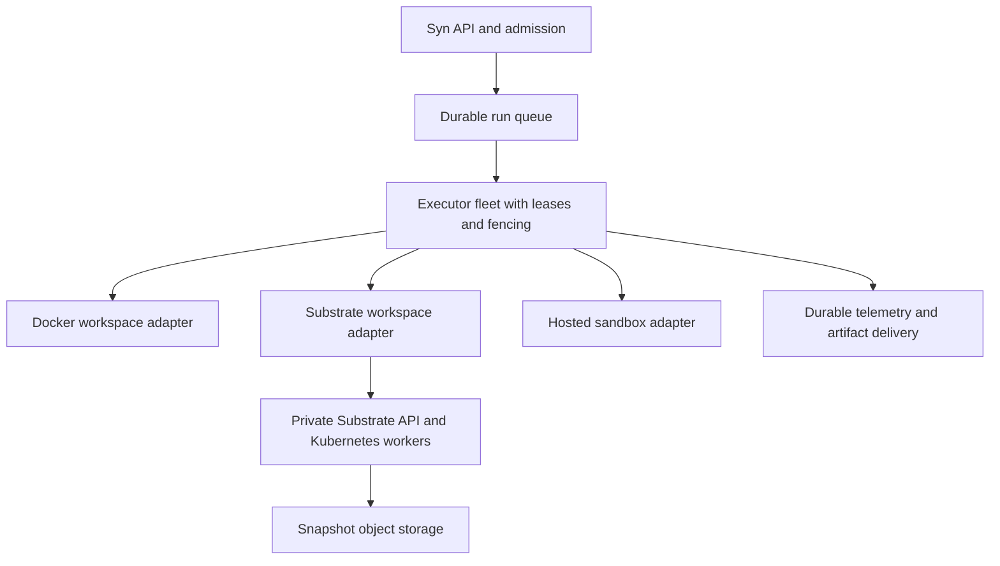

# Substrate assessment and Syntropic137 scaling options

Date: 2026-10-12. Research only. No infrastructure or runtime changes.

Substrate is worth piloting as a workspace backend. It is not yet a justified production dependency for hostile multi-tenant workloads, and its advertised density does not establish capacity for 100 or 1,000 actively working coding agents. Complete the executor split, measure representative workloads, and compare Substrate against additional Docker hosts and hosted sandboxes before choosing.

## Scope and confidence

- Substrate source snapshot: [`14bbd8012b4f0ba95b9fe2439f74be93da25e598`](https://github.com/agent-substrate/substrate/tree/14bbd8012b4f0ba95b9fe2439f74be93da25e598).
- Syntropic137 checkout: `a601fcbbf`; existing dirty submodules and files left untouched.
- Targeted static review: authentication, authorization, ingress, credential handling, snapshot lifecycle, CI, workspace ports and execution hosting. Not a complete penetration test or dependency vulnerability assessment.
- Substrate has 526 non-vendor `*_test.go` files. CI defines race tests, root-required tests, ARM64 builds, gVisor/microVM E2E lanes, and checks that test lanes actually ran. These are engineering signals, not proof of correctness or passing current CI.
- Local targeted tests could not start: Substrate requires Go 1.27; installed Go is 1.26.3. No cluster or performance benchmark was run.
- Historic VPS observations below come from repository documents, not a fresh inspection of the server.

## What Substrate provides

Substrate maps logical **actors** onto a pool of physical **workers** in Kubernetes. It checkpoints idle actors, releases workers, then restores actors when needed. gVisor and Cloud Hypervisor microVMs provide sandbox classes; PostgreSQL stores control state; object storage holds snapshots. OCI images remain the workload packaging format. [Architecture](https://github.com/agent-substrate/substrate/blob/14bbd8012b4f0ba95b9fe2439f74be93da25e598/docs/architecture.md).

This is useful for persistent environments with long idle intervals. It saves neither required compilation CPU nor model tokens. The [Claude multiplex demo](https://github.com/agent-substrate/substrate/blob/14bbd8012b4f0ba95b9fe2439f74be93da25e598/demos/claude-code-multiplex/README.md) uses three agents and two pods; its entrypoint invokes a short prompt and sleeps between invocations. It does not establish performance for our multi-hour SDLC workflows or transparent suspension during an active inference stream.

Distinguish four counts: registered workspaces, suspended workspaces, active executions, and simultaneously runnable CPU-heavy tasks. Syntropic137's north star counts active work, excludes queued/idle slots, and requires 30 minutes of sustained load with dashboard p95 below 500 ms and no lost executions or events. A thousand registered actors on ten workers does not satisfy that acceptance test.

## Quality and security findings

Severity reflects the proposed integration and exposure. Findings are not claims of a sandbox escape.

### High: most API authorization is disabled by default

- **Location:** `cmd/ateapi/main.go:81,323-328`; `cmd/ateapi/internal/authz/interceptor.go:25-36`.
- **Root cause:** `--experimental-enable-authz` defaults to false. Ordinary registered RPCs bypass permission checks unless marked `alwaysEnforce`; even with enforcement enabled, unregistered methods pass through this interceptor.
- **Impact:** authenticated clients must largely be treated as cluster administrators under the default configuration. An atespace is not a sufficient tenant boundary.
- **Fix for integration:** private API, one narrowly controlled Syn service identity, no actor/user control-plane credentials. Before broader exposure, enable and test authorization, require complete RPC registration and fail closed for missing rules.
- **Evidence:** [flag and wiring](https://github.com/agent-substrate/substrate/blob/14bbd8012b4f0ba95b9fe2439f74be93da25e598/cmd/ateapi/main.go#L81), [interceptor](https://github.com/agent-substrate/substrate/blob/14bbd8012b4f0ba95b9fe2439f74be93da25e598/cmd/ateapi/internal/authz/interceptor.go#L25).

### High if reachable by untrusted callers: ingress selects and resumes actors without caller authorization

- **Location:** `cmd/atenet/internal/router/ingress/ingress.go:78-109`; `cmd/atenet/internal/router/xds.go:1213-1224`.
- **Root cause:** the ingress handler parses the target actor header and resumes the actor without an end-user permission decision. Its downstream TLS setup serves a certificate but does not itself require a client certificate. Gateway-to-worker mTLS protects a different hop.
- **Impact:** a caller who can reach an unprotected router can target actor endpoints. The sandbox demo exposes command execution and explicitly disclaims authorization.
- **Fix:** authenticated Syn-owned ingress with per-execution/actor authorization before wakeup, internal-only router, NetworkPolicies preventing bypass. Do not expose the sandbox demo as a production execution service.
- **Evidence:** [handler](https://github.com/agent-substrate/substrate/blob/14bbd8012b4f0ba95b9fe2439f74be93da25e598/cmd/atenet/internal/router/ingress/ingress.go#L78), [demo warning](https://github.com/agent-substrate/substrate/blob/14bbd8012b4f0ba95b9fe2439f74be93da25e598/demos/sandbox/README.md).

### High for adoption of the demo: raw inference credential in actor template

- **Location:** `demos/claude-code-multiplex/agent-luna-template.yaml.tmpl:21,41-45`; analogous templates for the other agents.
- **Root cause:** installer substitutes the Anthropic API key into an ordinary template environment value; memory snapshots preserve process state.
- **Impact:** the agent can read the key; template readers can retrieve it, and snapshots can preserve sensitive process memory. The demo does not implement the advertised credential-free pattern.
- **Fix:** actor-identity-bound egress credential injection, separate credential broker, short-lived repository access, redaction and no raw reusable credentials in images/templates/snapshots. Validate Claude and Codex authentication separately; API-key injection does not prove OAuth compatibility.
- **Evidence:** [template](https://github.com/agent-substrate/substrate/blob/14bbd8012b4f0ba95b9fe2439f74be93da25e598/demos/claude-code-multiplex/agent-luna-template.yaml.tmpl#L21).

### High for hostile multi-tenancy: snapshot and node containment controls remain incomplete

- **Location:** `docs/security.md:42-46,68-69,85`.
- **Documented gaps:** per-actor encryption and restore authorization, node blast-radius containment, deletion guarantees and comprehensive quotas are incomplete or future work.
- **Impact:** storage segregation alone does not prove protection against a compromised supervisor, stale permissions, residual cached state or resource exhaustion.
- **Fix:** single-trust-domain pilot; separate control-plane nodes; least-privilege storage identities; encrypted disks/buckets and caches; retention/deletion verification; worker caps and admission quotas. Provider-managed encryption is distinct from per-actor cryptographic isolation.
- **Evidence:** [security status](https://github.com/agent-substrate/substrate/blob/14bbd8012b4f0ba95b9fe2439f74be93da25e598/docs/security.md#L35). These are acknowledged gaps, not independently reproduced exploits.

### Medium: eviction survival requires application cooperation

- **Location:** `docs/api-guide.md:544-559`.
- **Root cause:** Substrate signals the actor's main process; the harness must arrange suspension before eviction. It does not automatically checkpoint every running actor. Abrupt loss restores at most the last snapshot.
- **Impact:** vanilla CLI/container shutdown behavior can lose work. Spot termination gives substantially less time than a normal drain.
- **Fix:** explicit termination handshake, bounded checkpoint or salvage, durable capture, and recovery tests. Do not enable Spot until termination and replay behavior is proven.
- **Evidence:** [eviction contract](https://github.com/agent-substrate/substrate/blob/14bbd8012b4f0ba95b9fe2439f74be93da25e598/docs/api-guide.md#L544).

### Medium: documentation does not consistently describe current behavior

Authentication documentation says RBAC is unimplemented, while source contains experimental OpenFGA checks. Security documentation says UDP passthrough, while the egress guide says non-DNS UDP is blocked. Treat neither statement as a substitute for an executable isolation test. The project explicitly declares pre-1.0 compatibility instability. [Authentication](https://github.com/agent-substrate/substrate/blob/14bbd8012b4f0ba95b9fe2439f74be93da25e598/docs/authentication.md), [egress guide](https://github.com/agent-substrate/substrate/blob/14bbd8012b4f0ba95b9fe2439f74be93da25e598/docs/egress-traffic.md), [project status](https://github.com/agent-substrate/substrate/blob/14bbd8012b4f0ba95b9fe2439f74be93da25e598/README.md#status-and-compatibility).

## Syntropic137 limits in this checkout

| Constraint | Evidence and implication |
|---|---|
| One host saturates near current concurrency | `docs/north-star.md` records nine executions saturating a 16-core/62 GB VPS; October 8 operator report describes CPU pressure at ten. Load average is not CPU-seconds and cannot size a fleet reliably. |
| Admission is process-local | `apps/syn-api/src/syn_api/execution_budget.py:1-17,103-119`; default concurrency four in `settings/execution.py`, operator override ten. Raising the value does not create capacity. |
| Executor separation has started but is not wired | `ExecutionRunQueuePort.py` and `syn_adapters/execution_runs/postgres.py` implement a durable queue, leases, heartbeats and fencing. Search found no use of `PostgresExecutionRunQueue` or `ExecutionRunQueue` in `apps/syn-api/src`, nor a process-role/ExecutionHost implementation there. This is partial delivery, not an absent design. See ADR-072. |
| Runtime placement is Docker-specific | `AgenticIsolationAdapter.__init__` constructs `WorkspaceDockerProvider`, maintains process-local workspace handles and uses host/container directory mappings. Cloud settings exist but do not establish a working cloud provider. |
| Credentials still enter workspaces | `WorkspaceProvisionHandler.py:219-269` injects Claude credentials; Codex uses staged auth.json. Moving the current container to a remote cluster carries those secrets with it. |
| Disk and telemetry grow with throughput | October 8 research reports about 58 GB free on a 290 GB disk. Workspace usage includes CPU, throttling, peak memory, disk and network fields, but coverage and fleet aggregation require measurement. |
| External budgets remain independent | Provider quotas, GitHub polling, shared proxy limits and trigger guards must be sized independently of host capacity. Backend replacement does not remove them. |

The earlier [October 8 assessment](2026-10-08-scale-to-100.md) and [north star](../north-star.md) remain useful, but implementation status must be checked against current code. No assertion here establishes the current VPS deployment state.

## Integration boundary and proposed design

Keep workflow decisions in Syn aggregates and projections. Keep run ownership in the existing Run Queue design. Substrate schedules physical actor capacity; it must not decide the next workflow phase. Logical execution capacity, physical worker capacity and model-provider budgets are separate controls.

Implement the reusable Substrate workspace provider in **agentic-workspace**, following its existing provider contracts. A Rust client/runner is appropriate for new reusable runtime tooling; use generated protocol bindings. Keep the thin typed Python mapping in `syn-adapters`, preserving the current application architecture. Reuse existing Claude/Codex harness adapters rather than duplicating transcript parsing. Image changes require the submodule's protected release and a digest-pin bump here.

The Syn adapter must satisfy both `IsolationBackendPort` and `EventStreamPort`, not just creation/deletion:

| Contract | Substrate integration requirement |
|---|---|
| Create/destroy | Stable execution/workspace identity mapped to actor UID; deterministic create/reconcile; idempotent termination and snapshot retention/deletion. |
| Execute/stream | Authenticated actor-side execution service with argv, cwd, environment, deadlines, cancellation, exit status, and stdout/stderr delivery. The sandbox demo is an example, not a production transport. |
| Files/artifacts | Authenticated upload/download or scoped object-storage transfer; path confinement, archive traversal protection, size limits and integrity checks. Existing byte-buffered copy APIs need streaming extensions before large artifacts. |
| Capture | Durable cursor/spool and replay deduplication across stream reconnects, actor moves and executor failure; stable execution/phase/session attribution. Native pod logs alone do not establish this contract. |
| Suspend/resume | Optional explicit backend capability. Initially suspend only at validated idle/task boundaries; health checks must distinguish suspended from failed. Do not add a domain execution pause state merely because the backend hibernates. |
| Security | Syn authorizes access before the router; workload identity scopes credential vending and egress. Retain signed digest verification and current network restrictions. |

Start with one actor per phase workspace to match current isolation and cleanup semantics. Reusing actors across phases changes isolation, persistence and capture semantics and needs its own decision. Recovery must still support the existing restart-from-last-completed-domain-event model. A RAM snapshot is not an exactly-once guarantee: replayed GitHub/API side effects still need idempotency and fencing.

## Capacity and cost model

All amounts USD, before tax. Scenarios are not quotes or measured requirements.

Use **mean** resources over representative active execution time, plus burst distributions. Let N be active executions, c mean consumed cores per execution, m resident GiB per execution, U target utilization and R reserved control-plane capacity:

`required worker cores = ceil(N * c / U)`

`required fleet RAM >= active resident RAM + warm-worker overhead + caches + reserve`

Provision each node for its own worst permitted placements. Add R separately or host the control plane elsewhere. Average demand does not prove burst/deadline behavior. Physical cores and cloud vCPUs are not interchangeable performance units; benchmark the selected machine type.

For illustration only, reuse the north-star estimate c=1.2, choose U=75%, and reserve control-plane resources separately:

| Active executions | Worker CPU units | Working disk at assumed 1-3 GiB each |
|---|---:|---:|
| 20 | 32 | 20-60 GiB |
| 100 | 160 | 100-300 GiB |
| 1,000 | 1,600 | 1,000-3,000 GiB |

RAM, disk IOPS and burst gates can force more nodes. Current 2 CPU/4 GiB workspace caps are ceilings, not measured consumption or reservations. Do not apply a second idle-duty discount to c if its measurement already includes inference waits.

For Substrate, measure worker-occupying duty fraction d independently of CPU duty. A rough worker count is `ceil(N*d/U)` only when safe suspension is available and the workload meets latency goals. At N=100 and d=20%, this gives 27 workers; it is a hypothesis to test, not evidence of 100 active agents on 27 workers. Short synchronized bursts can require many more.

### Hosted sandbox reference price

[E2B pricing](https://e2b.dev/pricing), checked October 12: $0.000014/vCPU-second and $0.0000045/GiB-second. A 2-vCPU/4-GiB sandbox costs **$0.1656/hour** while running. Pro is $150/month with 100 concurrent sandboxes; the displayed 1,100-concurrency add-on is $1,000/month. Provider limits and account approval still need validation.

| Occupied sandboxes | Usage per hour | Usage for 730 hours | Displayed plan plus usage |
|---|---:|---:|---:|
| 100 | $16.56 | $12,088.80 | $12,238.80/month |
| 1,000 | $165.60 | $120,888.00 | $122,038.00/month |

These are uninterrupted running-time scenarios with fixed allocation. They exclude Syn hosting, inference and storage outside the included allowance. Running 160 hours/month changes usage to $2,649.60 and $26,496 respectively, before plan fees. Pausing helps only where compatible with the workflow and service contract.

### Self-managed scenario

An **assumed**, memory-inclusive worker price of $0.04-0.08 per provisioned CPU-unit-hour gives $6.40-12.80/hour for 160 units, or $4,672-9,344/month at 730 hours. At 1,000 executions the arithmetic is ten times those figures. These prices are sensitivity inputs, not a vendor quote; replace them with actual nodes and measured throughput. Bare metal and cloud vCPUs differ. Add Kubernetes/control-plane hosts, database/HA, disks, networking, snapshots, monitoring and operations. Substrate software does not include those resources.

Scale-down must remove billable nodes to lower node costs. Suspending actors while keeping the same warm node pool lowers utilization but not the VM invoice.

### Storage and snapshot traffic

Separate workspace scratch/cache, checkpoints, retained artifacts, and telemetry. Model copies, backups and retention explicitly.

- Assume 2 GiB per retained checkpoint and ten versions: 100 actors retain 2,000 GiB; 1,000 retain 20,000 GiB. At about $0.02/GiB-month for regional standard object storage, that is about $40/$400 per month for bytes alone. [Google Cloud Storage pricing](https://cloud.google.com/storage/pricing).
- Assume 100 MiB telemetry/artifacts per completed run, mean duration two hours and continuous occupancy: 100 active runs produce 1,200 completions/day and about 117 GiB/day. Thirty-day retention is about 3,516 GiB; at 1,000 runs, about 35,156 GiB. These are invented inputs to illustrate throughput-driven growth; measure actual capture size.
- Full 2-GiB snapshots of 1,000 actors every five minutes would write **24,000 GiB/hour**, about **6.67 GiB/second** before restores. Compression, sparse data, caching and incremental snapshots may reduce this; measured transferred bytes determine the result. Cheap stored bytes do not imply cheap or fast checkpoint traffic.
- Add request charges, SSD cache/IOPS, backup replication, cross-zone/region transfer, egress and restore latency. Colocate workers, snapshots and database where practical.

### Inference and total economics

`starts/hour = active concurrency / mean active execution duration`

`inference $/hour = starts/hour * mean billed inference $/execution`

Using the historical implement-v3 **scenario** of mean duration two hours and $3-12/run gives $150-600/hour at 100 active executions, and $1,500-6,000/hour at 1,000. That likely exceeds worker cost for that workload, but historical API-equivalent token accounting is not a subscription invoice. Reconcile current model/cache pricing and real bills before budgeting.

`total = inference + worker compute + control plane/database + scratch disks + snapshots + artifacts/telemetry + network + platform fees + operations + failed/retried work`

Track cost per successfully accepted change alongside cost per run. Lower host cost with more deadline failures can increase total delivery cost.

## Recommended sequence

1. **Measure current runs.** Ramp 2/4/8/10 executions; capture phase CPU-seconds, throttling, wall time, memory peak, disk high-water mark, network, build/test bursts, inference waits, tokens, retries and success rate. Existing teardown counters are a starting point, not an in-phase peak sampler.
2. **Finish ADR-072 wiring.** API/executor roles, durable claims, leases, fenced cancellation, capture recovery and deploy survival. Test multiple executor processes before adding a remote backend. Do not create a second queue.
3. **Prove 20 on suitable capacity.** Improve dependency reuse and constrain nested build parallelism, then size admission from evidence. More Docker executor hosts remain a viable route; Docker itself does not impose a ten-workspace limit.
4. **Pilot Substrate at 5-10 real SDLC workspaces.** Private single-trust-domain cluster, pinned images, authenticated execution transport, credentials outside actors, explicit eviction handling. Compare identical workloads against Docker and E2B. Measure completed work/hour, active-worker duty, p95 startup/restore, snapshot bytes, cost/accepted change and missing/duplicate capture events.
5. **Prove 100.** Multi-host ownership, independent provider quotas, burst capacity, GitHub budget, database pools and observability. Inject executor/node loss and deploy during the acceptance run. Never count parking queues as active concurrency.
6. **Prove 1,000.** Autoscaling, bounded warm capacity, per-tenant budgets, durable capture backpressure, storage retention, authorization/isolation tests and recovery drills. Size from measured bottlenecks, not a tenfold configuration increase.

Prefer Docker executor expansion for the shortest path if workload CPU remains dominant. Prefer hosted sandboxes when operational simplicity and burst access justify their rate. Prefer Substrate when a real pilot proves enough safely reclaimable idle time to cover Kubernetes, snapshot traffic and operational complexity. Preserve all three options behind the same ports.
