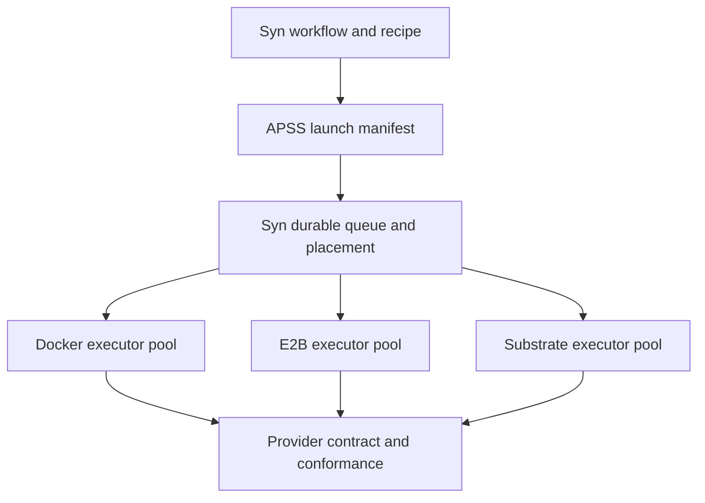

# Workspace abstraction reuse assessment

Keep APSS as the portable launch contract. Implement its existing requirements before expanding it. Reuse established execution and provider patterns; keep fleet scheduling in Syntropic137. The current runtime is not yet a conformant, remote-ready implementation.

## Existing abstractions

| Project | Relevant overlap | Recommended use |
|---|---|---|
| OpenSandbox | Separate lifecycle and execution APIs; command status, output streaming, cursor-based background logs, files | Evaluate an adapter and its execution service before building a custom remote protocol |
| Harbor | Shared environment interface with Docker, E2B, Modal, OpenSandbox and other adapters; explicit capabilities | Reference provider semantics and capability modeling; avoid coupling Syn to its evaluation job/trial model |
| Inspect | Pluggable lifecycle, execution and file interface, with cloud/cluster implementations | Evidence that a small provider port is an established pattern |
| Kubernetes Agent Sandbox | Kubernetes sandbox lifecycle, templates, claims and warm pools | Possible fleet backend when operating Kubernetes; does not replace a cross-provider launch contract |
| Substrate | Actor lifecycle and state persistence across supported execution substrates | Later provider candidate after the security and recovery issues in the separate assessment |

OpenSandbox separates lifecycle from execution, and compatibility requires matching behavior, not only endpoint names. Its current contracts have no universal capability-negotiation endpoint. Supporting its lifecycle API alone does not supply command/file execution. Target a pinned version and explicit operation subset. [Compatibility documentation](https://open-sandbox.ai/api/implementation-compatibility).

Harbor is the closest reviewed example of the requested multi-provider adapter layer. Its registry includes Docker, E2B, Modal and OpenSandbox. Its capability types distinguish network-policy features and resource requests from hard limits. That distinction is worth adopting. [Registry](https://github.com/harbor-framework/harbor/blob/b53b8134e1241686dca7759af188f987ecc48e8b/src/harbor/environments/factory.py), [capabilities](https://github.com/harbor-framework/harbor/blob/b53b8134e1241686dca7759af188f987ecc48e8b/src/harbor/environments/capabilities.py).

Inspect similarly separates lifecycle from process/file operations. Kubernetes Agent Sandbox addresses cluster infrastructure. These reinforce the architecture without supplying Syn's full recipe, capture, event-sourced ownership and mixed-fleet behavior. [Inspect provider interface](https://inspect.aisi.org.uk/extensions-sandboxes.html), [Agent Sandbox documentation](https://agent-sandbox.sigs.k8s.io/docs/).

Assessment: the provider-port pattern is established. APSS's useful role is specifying what an agent launch means across those providers. None of the reviewed interfaces is a drop-in replacement for all the requirements above.

## Existing APSS requirements versus implementation

Normative baseline: EXP-V1-0006 version 0.1.0, Experimental, pinned by `lib/agentic-workspace/Cargo.toml:29` to APSS commit `18d55b231e7d06b509386b2599f925195b63ba0c`. Specification: `standards-experimental/v1/EXP-V1-0006-workspace/docs/01_spec.md` in that dependency.

| Already required | Current runtime gap |
|---|---|
| Cancellation, status, logs, observe and finalize | Rust provider trait exposes provision/hydrate/execute/collect/destroy only |
| Required capture envelope | Conformance coverage marks transcript integration pending |
| Repository resolution and skill digest verification | Rust Docker rejects repository and skill declarations |
| Tool policy and capabilities enforced or refused | Rust Docker currently refuses declarations; this is safe refusal, not feature support |
| Resource limits enforced or refused | CPU/memory supported; disk refused |
| Result correlation, metadata and effective model when known | Result contains exit code, stdout, stderr and timeout only |

Sources: [provider types and trait](../../lib/agentic-workspace/crates/workspace-core/src/lib.rs), [Docker implementation](../../lib/agentic-workspace/implementations/docker/src/lib.rs), [coverage matrix](../../lib/agentic-workspace/tests/conformance/COVERAGE.md).

The synchronous trait buffers output and artifacts in memory and exposes local filesystem roots. These are implementation choices to change for remote execution and bounded resource use. The shared conformance helper currently covers a successful command/artifact round trip and repeated teardown; it does not establish the complete APSS guarantees.

Correction to the earlier assessment: cancellation, status, logs and finalization are primarily implementation debt, not missing APSS concepts. APSS itself requires a remote provider before promotion. Docker and Local alone are explicitly insufficient.

## Contract details worth resolving with a remote provider

1. **Identity and uncertain outcomes.** Stable provider operation identity, idempotency keys, reconnect/adoption and a distinct unknown outcome. A timeout or disconnected client must not imply the agent stopped. Provider retries must not silently launch duplicate work.
2. **Results and observation.** Versioned status/result schemas, stream cursors, terminal states, primary versus cleanup failure, and typed transport/quota/authentication errors. Keep telemetry payloads in the observability lane.
3. **Capabilities and security.** Machine-readable supported features and constraints. Distinguish enforceable isolation, egress policy, hard limits and reservations. Snapshot/resume remain optional. APSS already prohibits raw secrets in manifests; specify how execution-scoped credential references reach a provider.
4. **Portable content.** Immutable input references with digest/size, transfer semantics and durable artifact references. A remote worker cannot assume the API host's paths exist.
5. **Reproducible environments.** Environment/toolchain identity with provider-specific realizations. An OCI image and an E2B template need a defined mapping; their identifiers are not interchangeable.

These are candidate clarifications/extensions, not a reason to redesign every manifest now. Strict readers reject unknown fields, so schema changes require explicit versioning under the current APSS rules.

## Recipe and fleet boundaries

The current Python recipe includes harness, model, skills and instructions, but no tools. Add reusable tool requirements there, then compile them into runtime requirements and enforceable tool policy. Installed binaries, allowed harness tools and MCP services are different requirements. Recipe identity should not contain raw credentials or provider allocation IDs. [Recipe definition](../../lib/agentic-workspace/lib/python/agentic_isolation/agentic_isolation/recipe.py).

The current itmux run contract still uses local recipe/input paths and inline credentials; its executor provisions Docker directly. Wiring it through the shared provider contract is integration work, not evidence of another required standard. [Run contract](../../lib/agentic-workspace/implementations/docker/interactive-tmux/driver-rs/src/run/contract.rs), [executor](../../lib/agentic-workspace/implementations/docker/interactive-tmux/driver-rs/src/run/workspace_executor.rs).

Each executor pool using one provider is a useful deployment choice. Multiple pools can run simultaneously. Workflows request requirements; placement selects an eligible pool. Provider-specific hints remain advisory.

Syn owns durable attempt identity, pool registration, placement, budgets, quotas, lease ownership/fencing, retry decisions, reconciliation and domain transitions. Providers own physical resource lifecycle, transport and idempotent operations. Persist enough opaque provider identity for another worker to reconcile after a crash. Do not put vendor handles or telemetry in workflow domain events merely to make them durable; use an infrastructure execution registry.

APSS explicitly excludes scheduling and consumer domain models. Existing Syn durable queue/claim machinery should be integrated rather than replaced by another in-memory dispatcher. [Queue port](../../packages/syn-domain/src/syn_domain/contexts/orchestration/ports/ExecutionRunQueuePort.py), [Postgres implementation](../../packages/syn-adapters/src/syn_adapters/execution_runs/postgres.py).

## Recommended next proof

1. Complete a shared provider contract and conformance matrix against existing APSS MUST requirements.
2. Run the same representative phase on Docker and E2B, preserving recipe, capture and artifact behavior. Evaluate OpenSandbox as an adapter/execution service candidate, not a mandatory new layer.
3. Exercise mixed pools, cancellation, stream reconnect, executor death mid-provision/mid-run, teardown failure and artifact recovery. Reconcile uncertain remote work before retrying; use explicit policy for non-idempotent agent side effects.
4. Extend APSS only where that proof exposes a real portability gap. Keep harness/provider changes in agentic-workspace and fleet/domain changes in Syn.
5. Meet the existing 100-execution load bar, then repeat at 1,000: active work sustained 30 minutes, dashboard p95 below 500 ms, no lost/orphaned executions and reconciled capture. Passing provider tests alone does not prove fleet capacity. [North star](../north-star.md).

For placement and cost, record per-attempt provision/active/idle duration, allocated CPU/RAM, retained storage, snapshots, transfer and provider billing units. Derive infrastructure cost alongside inference cost. Capability claims and allocations are not measured utilization. Existing sizing and E2B pricing remain in the [Substrate scaling assessment](2026-10-12-substrate-scaling-assessment.md).

## Review scope

Source/interface review, 2026-10-12. OpenSandbox release-1.1.1 commit `531700ca18a7fa5fab6a2f25d6dc68a76eddab12`; Harbor v0.24.0 commit `b53b8134e1241686dca7759af188f987ecc48e8b`. No runtime, fault-injection or load tests performed. These recommendations do not establish production readiness of either project.
